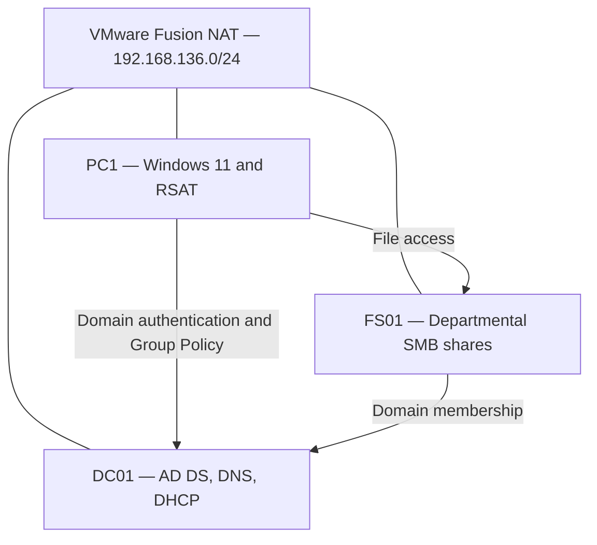

# Windows Server 2025 — Active Directory & IT Support Lab

## Project Overview

This home lab simulates an organization with IT, HR, and Sales departments. I configured centralized identity management, workstation policies, departmental file access, automatic network drive mapping, and delegated Help Desk account support.

The environment runs in VMware Fusion on an Intel MacBook Pro, using two Windows Server 2025 virtual machines and one Windows 11 client.

## Lab Environment

| System | Operating System | Role | IPv4 Address |
|---|---|---|---|
| DC01 | Windows Server 2025 | Active Directory Domain Services, DNS, DHCP | 192.168.136.10 |
| FS01 | Windows Server 2025 | Domain member and file server | 192.168.136.20 |
| PC1 | Windows 11 | Domain client and RSAT workstation | 192.168.136.40 via DHCP |

- **Domain:** corp.lab.test
- **NetBIOS name:** CORP
- **Subnet:** 192.168.136.0/24
- **Default gateway:** 192.168.136.2
- **Client and file server DNS:** 192.168.136.10
- **Virtual networking:** VMware Fusion NAT

## Architecture

## 1. Active Directory Organization

I organized domain objects under a Global OU with separate locations for:

- Admin Accounts
- Groups
- Servers
- Service Accounts
- Users, with IT, HR, and Sales child OUs
- Workstations

Departmental test accounts were assigned to their corresponding global security groups:

| Department | Test Account | Global Security Group |
|---|---|---|
| IT | it.user01 | GG_IT_Users |
| HR | hr.user01 | GG_HR_Users |
| Sales | sales.user01 | GG_Sales_Users |

This structure separates user, workstation, server, and administrative objects for policy targeting and delegation.

[View OU structure](screenshots/01-ad-ou-structure.png)

## 2. DHCP and Network Validation

I configured the Building A DHCP scope on DC01:

| Setting | Value |
|---|---|
| Address range | 192.168.136.40–192.168.136.254 |
| Exclusion range | 192.168.136.41–192.168.136.45 |
| Router — option 003 | 192.168.136.2 |
| DNS server — option 006 | 192.168.136.10 |
| DNS domain — option 015 | corp.lab.test |

PC1 received its network configuration through DHCP. I checked the assigned address, gateway, DNS settings, and network connectivity.

[View DHCP scope options](screenshots/07-dhcp-scope-options.png)

## 3. Group Policy

I configured and tested:

- A workstation logon banner.
- Windows Defender Firewall enabled for Domain, Private, and Public profiles.
- Default inbound traffic blocked and default outbound traffic allowed.
- A user policy restricting access to Control Panel and PC settings.
- Automatic network drive mappings.

I used Group Policy results on PC1 to check applied computer and user policies.

[View firewall verification](screenshots/13-pc1-firewall-profiles-verified.png)

[View Control Panel restriction test](screenshots/16-pc1-control-panel-blocked.png)

## 4. File Server and Access Control

FS01 was joined to the domain and placed in the Servers OU. A separate NTFS data volume stores departmental folders under D:\Shares.

File access follows the AGDLP model:

**Accounts → Global groups → Domain Local groups → Permissions**

| Share | Global Group Membership | Domain Local Permission Group | NTFS Access | SMB Share Access |
|---|---|---|---|---|
| IT | GG_IT_Users | DL_FS_IT_Modify | Modify | Change and Read |
| HR | GG_HR_Users | DL_FS_HR_Modify | Modify | Change and Read |
| Sales | GG_Sales_Users | DL_FS_Sales_Modify | Modify | Change and Read |
| Public | All three departmental groups | DL_FS_Public_Read | Read and Execute | Read |

Permissions were assigned through groups rather than directly to individual departmental users. Administrative and SYSTEM permissions were retained.

The Public share provides read-only access to departmental users.

[View file server folder structure](screenshots/25-fs01-share-folder-structure.png)

[View HR NTFS permissions](screenshots/32-fs01-hr-ntfs-permissions.png)

### File Access Tests

Using IT, HR, and Sales accounts on PC1, I tested:

- Creating and writing files in the user's own departmental share.
- Access denial to other departments' shares.
- Reading files in Public.
- Write denial in Public.

[View IT Public read test](screenshots/51-pc1-it-public-read-test.png)

[View IT Public write denial](screenshots/52-pc1-it-public-write-denied.png)

## 5. Automatic Network Drive Mapping

The U-Users-DriveMaps GPO is linked to the Users OU. Group Policy Preferences use security group targeting to assign drives.

| Drive | UNC Path | Target Users |
|---|---|---|
| I: | \\FS01\IT | GG_IT_Users |
| H: | \\FS01\HR | GG_HR_Users |
| S: | \\FS01\Sales | GG_Sales_Users |
| P: | \\FS01\Public | IT, HR, or Sales group members |

Drive mappings use the Update action with Reconnect enabled.

I verified the resulting drives in separate departmental sessions:

- IT: I: and P:
- HR: H: and P:
- Sales: S: and P:

[View drive map configuration](screenshots/62-gpo-drive-maps-overview.png)

## 6. Delegated Help Desk Support

I created the GG_HelpDesk_L1 security group and the hd.tech01 account.

The Help Desk account was configured without Domain Admin membership. Delegation was applied to Global/Users and its departmental child OUs for:

- Resetting user passwords.
- Requiring a password change at next logon.
- Reading and writing lockoutTime to unlock user accounts.

I installed the RSAT Active Directory tools on PC1 and opened Active Directory Users and Computers from the Help Desk session.

### Password Reset Test

1. Reset the Sales test user's password using the Help Desk account.
2. Required a password change at next logon.
3. Signed in as the Sales user.
4. Completed the password change successfully.

[View Help Desk password reset success](screenshots/73-pc1-helpdesk-password-reset-success.png)

### Account Unlock Test

The domain account lockout settings used for this test were:

| Setting | Value |
|---|---|
| Account lockout threshold | 5 invalid attempts |
| Account lockout duration | 10 minutes |
| Reset account lockout counter after | 10 minutes |

I verified the policy with net accounts /domain, triggered a lockout on the Sales test account, unlocked it through the Help Desk workflow, and confirmed successful Sales user sign-in afterward.

[View verified lockout policy](screenshots/77-dc01-account-lockout-policy-verified.png)

[View locked account test](screenshots/78-pc1-sales-account-locked-out.png)

[View successful login after unlock](screenshots/80-pc1-sales-login-after-unlock.png)

## Evidence Index

The screenshot collection documents configuration and testing.

| Screenshot Range | Topic |
|---|---|
| 01–05 | Active Directory OUs, groups, and departmental accounts |
| 06–09 | DHCP and client network validation |
| 10–19 | Group Policy configuration and client verification |
| 20–25 | File server networking, domain membership, and storage |
| 26–29 | File access group membership |
| 30–37 | NTFS and SMB share permissions |
| 38–52 | Departmental and Public share access tests |
| 53–65 | Drive mapping configuration, targeting, and verification |
| 66–72 | Help Desk account, delegation, and RSAT |
| 73–80 | Password reset, forced password change, lockout, and unlock |

[Browse screenshots](screenshots/)

## Validation Scope and Limitations

The documented tests cover departmental file access, Public read-only access, drive mappings, applied policies, password reset, forced password change, and account unlock.

Negative Help Desk tests for unrelated attribute changes and accounts outside the delegated OU were not performed. The successful support tests therefore do not establish that every delegation boundary was validated.

Automatic drive removal after group membership changes was not tested.

This is a learning environment with one domain controller and one file server. Production availability and recovery testing are outside the documented scope.

## Skills Practiced

- Active Directory user, group, and OU administration
- DNS and DHCP configuration
- Group Policy configuration and troubleshooting
- Windows domain membership
- SMB sharing and NTFS permissions
- AGDLP group-based access control
- Group Policy Preferences and drive targeting
- RSAT and delegated account support
- Password reset and account lockout troubleshooting
- Technical documentation and test evidence
